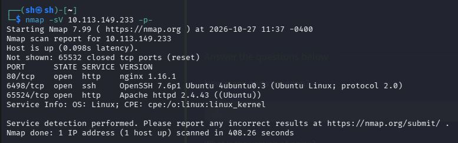
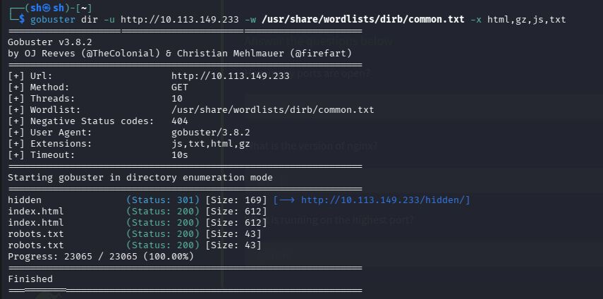
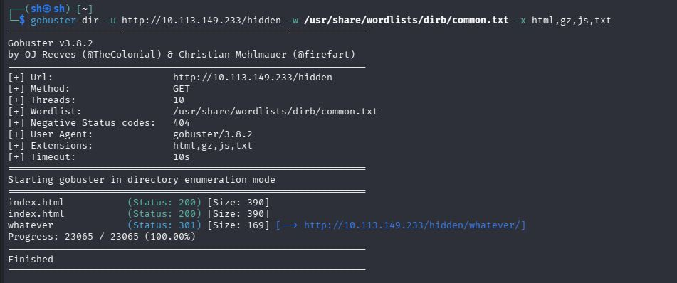
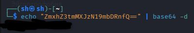
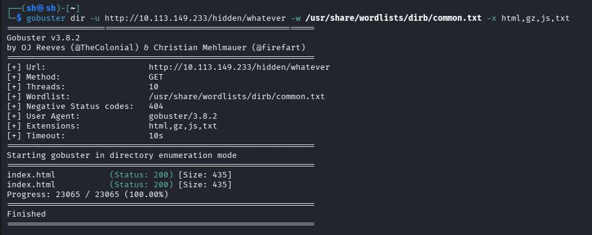
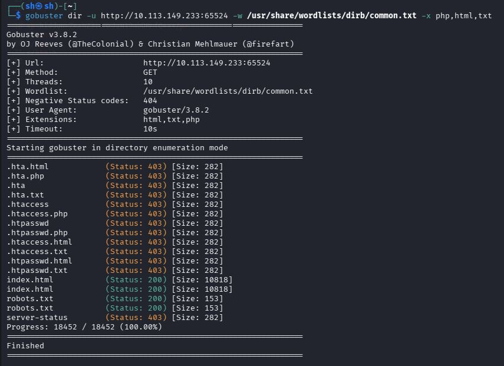
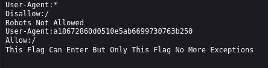
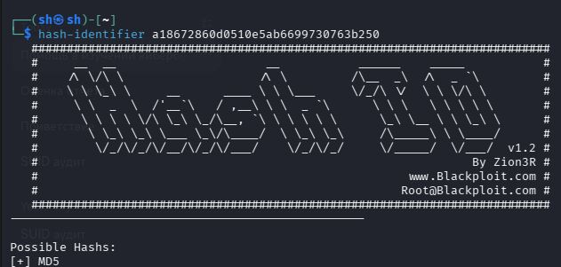
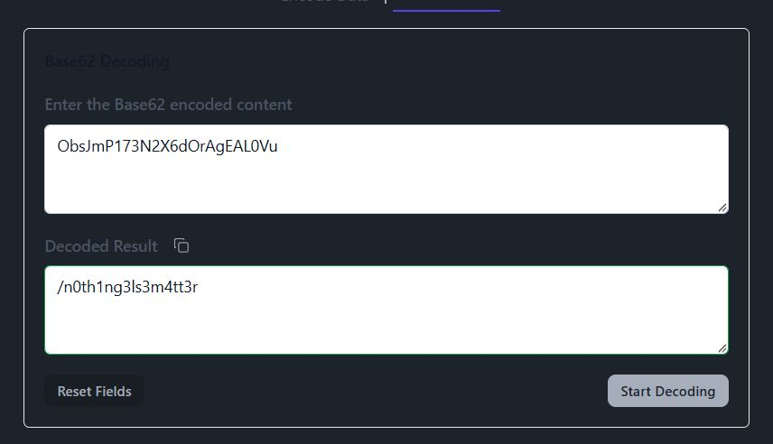

# TryHackMe: Easy Peasy

*Дата: 27.10.2026*

### Сложность: Easy

**Мой IP: 192.168.130.244**

**IP Цели: 10.113.149.233**

### **Лаборатория: TryHackMe, все действия легитимны**

**Инструменты: nmap, potom blyuat** 

---

Сегодня у меня ещё одна машинка, как обычно с TryHackMe - **Easy Peasy**. Название обещает что машинка будет *'легкой'* в чем я если честно сомневаюсь

Давайте начнём как обычно с `nmap`, просканируем все порты с флагом `-sV`:

```bash
nmap -sV 10.113.149.233 -p- # Раньше я использовал флаг -T4, но сейчас решил отказаться от него, ведь пару раз он терял несколько крайне важных портов
```



Итак, `nmap` показал нам несколько портов, в общем 3 порта. сайт `http` на `nginx 1.16.1`, `ssh` на нестандартном 6498-ом порте и `Apache` сайт на предпоследнем 65524 порте. Начнём с `nginx`, используем `gobuster`. Чаще всего по умолчанию на `nginx` встречаются файлы форматов `.html`, `.gz`, `.js` и иногда `.txt`, поэтому будем искать их в флаге `-x`:

```bash
gobuster dir -u http://10.113.149.233 -w /usr/share/wordlists/dirb/common.txt -x html,gz,js,txt
```



`gobuster` закончил анализ, и в общем дал довольно хороший результат. `index.html`, `robots.txt` и папка `/hidden`. Сначала я решаю посмотреть `index`, там обычное приветствие `nginx`, в коде страницы `(Ctrl+U` ничего не было, поэтому я решил идти дальше. `robots.txt` лишь показал, что роботы отключены на этом сайте. Теперь переходим в самое интересное, в `/http://10.113.149.233/hidden`, и здесь меня встречает.. ничего. Абсолютно пустая страница, я смотрю в код страницы, и в коде страницы понимаю, что здесь должна была быть png картинка, но я её не вижу потому что я живу в РФ и у нас проблемы с `TryHackMe`, но это не важно. Так как `/hidden` это папка, я решаю запустить `gobuster` и на неё тоже:

```bash
gobuster dir -u http://10.113.149.223/hidden -w /usr/share/wordlists/dirb/common.txt -x html,gz,js,txt
```



И `gobuster` показал мне внутри `/hidden` ещё одну папку - `/whatever`, я решил перейти и в неё тоже. На первый взгляд там ничего не было, но посмотрев в код страницы `Ctrl+U` я нашёл там не только какую-то новую картинку, но ещё и параграф `(<p p>)` на java! Внутри там была строка `ZmxhZ3tmMXJzN19mbDRnfQ==`, которая вероятно зашифрована. У меня уже есть теория что это `base64`, ведь строка состоит только из цифр, букв верхнего и нижнего регистра. А что выделяет её еще сильнее это `==` в конце, поэтому я решаю попробовать расшифровать это с помощью встроенной утилитой base64 в kali:

```bash
echo "ZmxhZ3tmMXJzN19mbDRnfQ==" | base64 -d
```



И у нас есть первый флаг, но на скриншоте я его замажу, потому что нужно самим искать!

Ладно, но стоит держать в голове, что `/whatever` в `/hidden` - тоже папка, и сейчас мы просканируем её с помощью `gobuster`:

```bash
gobuster dir -u http://10.113.149.223/hidden/whatever -w /usr/share/wordlists/dirb/common.txt -x html,gz,js,txt
```



Но в этот раз `gobuster` буквально ничего не показал, поэтому я решаю вернутся к выводу `nmap`. Помимо `ssh` на нестандартном порте, там был сайт `Apache` на 65524-ом порте, исходный код страницы я уже посмотрел и ничего не нашёл там, поэтому давайте теперь используем `gobuster` и тут, а так как сайт на `Apache`, в флаге `-x` мы будем использовать расширения `.php`, `.txt` и `.html`:

```bash
gobuster dir -u http://10.113.149.223:65524 -w /usr/share/wordlists/dirb/common.txt -x php,html,txt
```



И в этот раз `gobster` ничего не показал, кроме `robots.txt`, который я сейчас и проверю



И тут довольно ценная информация. Обратите внимание, этот файл находится в `robots.txt`, это означает что если мой `User-Agent = a18672860d0510e5ab6699730763b250`, то я получу доступ к чему-то. А так-же `a18672860d0510e5ab6699730763b250`, очень выглядит как шифровка `MD5`, потому что там 32 символа, цифры и буквы от a до f. Но говорить просто потому что кажется нельзя, нужно доказать. И это можно сделать с помощью встроенной утилиты `hash-identifier`:

```bash
hash-identifier a18672860d0510e5ab6699730763b250
```



И да, это шифровка `MD5`, да и к тому же `MD` без соли. Его можно взломать с помощью `hashcat` или `john`. Лично мне удобнее и привычнее пользоваться `hashcat` для взлома файлов формата `MD5`, поэтому прямо сейчас сделаем это:

```bash
echo "a18672860d0510e5ab6699730763b250" > md5-hash.txt
```

И теперь взламываем с помощью `hashcat`:

```bash
hashcat -m 0 -a 0 hash.txt /usr/share/wordlists/rockyou.txt # Флаг -m 0 означает взлом без соли, а -a 0 означает режим прямого перебора по словарю
```

Но результата не было, я не смог взломать хэш, поэтому решил использовать `a18672860d0510e5ab6699730763b250` прямо по назначению, с помощью команды `curl`:

```
curl -A "a18672860d0510e5ab6699730763b250" http://10.114.169.225:65524/robots.txt
```

Но это не дало мне результата. Я решил пересмотреть всё, что имею более глубоко. Я решил пропарсить код страницы `http://10.114.169.225:65524` с помощью искусственного интеллекта, и понял что действительно пропустил много чего

Первое что прямо в коде страницы был **третий флаг**, который я не заметил сразу. Ещё я не заметил строку `<p hidden>its encoded with ba....:ObsJmP173N2X6dOrAgEAL0Vu</p>`. Чтож, это повод более внимательно смотреть код страницы, учту. Если с третьим флагом всё понятно, то сейчас нам нужно разобраться с строкой `ObsJmP173N2X6dOrAgEAL0Vu`, в скрытом параграфе прямо написано `encoded with ba...` и текст обрывается. Смею предположить что он имел ввиду `base`, но `base`-ов много бывает. Есть 64, 62, 32.. но большие подозрения идут именно на 62-ой. Потому что шифр состоит из заглавный, строчных английских букв и цифр. Шифр не содержит спецсимволов Base64 `(+, /, =)` или выравнивания, что указывает на кодировку `Base62`. У меня в kali нету встроенной утилиты для расшифровки `base62`, поэтому чтобы сейчас не мучать свои нервы и не вспоминать другие команды я решаю использовать **онлайн декодер base62**, например `https://base62.org/`:



Откуда получаю результат `/n0th1ng3ls3m4tt3r`, что очень сильно похоже на папку

